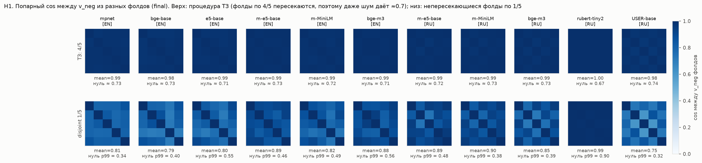
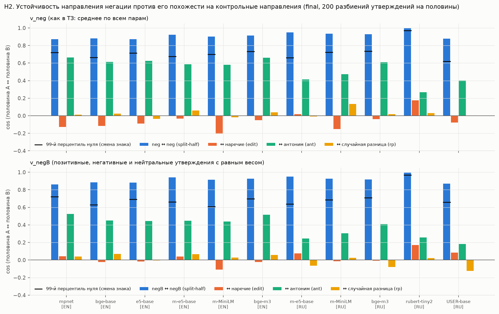
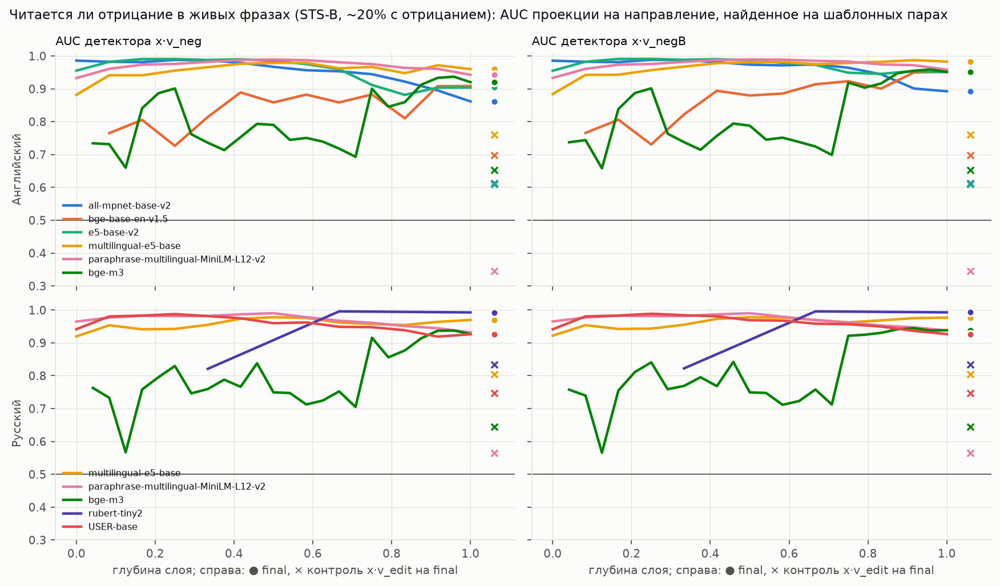
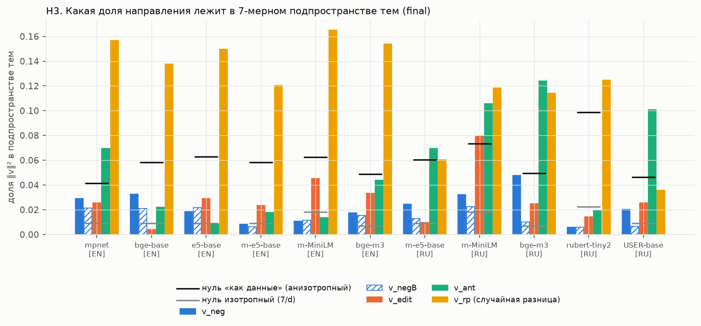
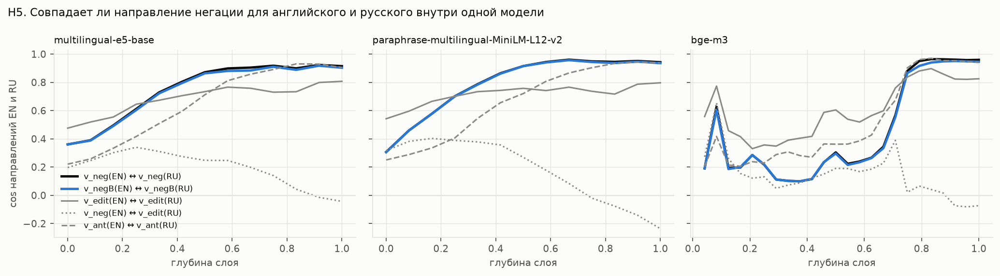

# Направление негации в sentence-эмбеддингах — итоговый отчёт

**Вопрос.** Существует ли в финальных sentence-эмбеддингах bi-encoder моделей (в векторе,
по которому реально ищут) устойчивое линейное направление «негации», как «gender» в
king − man + woman? И можно ли этой одной осью лечить «слепоту к отрицанию» без дообучения?

**Короткий ответ: направление есть, устойчивое и не сводящееся ни к «любой правке текста»,
ни к теме. Но на финальном выходе модели это в основном не «чистая негация», а смена
тональности, почти то же, что замена на антоним. Как дополнительный признак к косинусу оно
заметно снижает число ошибок; вычитать его из эмбеддингов вредно.**

Проверено на 6 моделях для английского и 5 для русского (11 пар «модель × язык»), по всем
слоям энкодера, с четырьмя контрольными направлениями.

- **H1, устойчивость: да, 11 из 11.** Направления, посчитанные по двум непересекающимся
  половинам утверждений, совпадают с cos 0.87–0.95. Нулевой уровень ≈ 0, его 99-й
  перцентиль 0.62–0.74. Процедура из
  ТЗ (фолды по 4/5) для проверки непригодна: её фолды пересекаются, и даже чистый шум
  даёт ≈ 0.7 (подробнее в §2.1).
- **H2, специфичность: частично.** От «любой правки» v_neg отличается: cos с
  направлением «вставили нейтральное наречие» от −0.22 до 0.02. Но с направлением
  «замена на антоним» он сильно перекрывается (очищенный от шума cos 0.48–0.84). В ТЗ
  предполагалось обратное.
- **Главная находка: на финальном выходе негация — это во многом смена тональности.**
  v_neg, посчитанный только на позитивных утверждениях, и v_neg только на негативных
  в английских моделях направлены **в противоположные стороны** (cos от −0.29 до −0.55
  при ожидаемых +0.83…+0.89). «Not great» сдвигается туда же, куда «terrible», а
  «not rude» — туда же, куда «polite». На ранних и средних слоях этого нет (cos
  0.88–1.00): переворот происходит в последней трети сети. В русском эффект слабее и есть
  не во всех моделях.
- **Если уравнять позитивные и негативные утверждения по весу (v_negB)**, остаётся
  устойчивая компонента (0.86–0.95), почти не связанная с тональностью. Она лучше
  определяет отрицание в живых фразах STS-B (AUC 0.89–0.99) и **совпадает для
  английского и русского внутри одной мультиязычной модели** (cos 0.90–0.95).
- **H3, ортогональность теме: да, 10 из 11.** В 7-мерное подпространство тем попадает
  0.6–4.8% квадрата нормы v_neg. Это меньше, чем у типичного направления в данных
  (4–10%), и втрое-вдесятеро меньше, чем у разности фраз на разные темы (4–17%).
- **H4, практическая польза: для признака — да в 8 из 11, частично в 2, нет в 1; для
  вычитания — нет.**
  - «Вычесть проекцию на v_neg» ухудшает результат у всех 11 моделей (значимо у 10).
  - Признак «разница проекций на v_neg» поверх косинуса снижает долю случаев, где
    отрицание оказалось ближе перефраза, например 0.44 → 0.19 (mpnet), 0.48 → 0.05 (e5),
    0.72 → 0.02 (multilingual-e5 на русском). Среднее по четырём типам ловушек
    улучшается у 10 из 11.
  - Цена: хуже становится случай, где правильный ответ сам содержит отрицание («not
    closed» = «open»). Это есть у 9 моделей, значимо у 2.
  - Простое правило «есть ли в тексте not/не» так не умеет: оно либо ломает этот случай
    полностью, либо ничего не даёт.
  - Whitening вредит, mean-centering ничего не меняет.
- **H5, слои и модели.** Негация читается лучше всего на ранних и средних слоях (среднее
  выравнивание пары с осью 0.70–0.97 против 0.38–0.62 на выходе), а к выходу
  смешивается с тональностью. Между моделями направление переносится линейным
  отображением, обученным без единого отрицания (cos 0.79 для EN, 0.67 для RU).

Из трёх исходов в ТЗ это ближе всего к **«сильному позитивному» с одной существенной
оговоркой**: направление существует, специфично относительно правок и темы и полезно как
признак. Но на финальном выходе оно не является чистой осью «негации». Существенная его
часть — ось «смены полярности», общая с антонимами.

---

## 1. Методология

### 1.1 Данные (`src/lexicon.py`, `src/s01_build_data.py`, seed = 42)

| Набор | Что это | Размер на язык | Зачем |
|---|---|---|---|
| pairs | 48 базовых утверждений × 5 нейтральных рамок; к каждому — отрицание, вставка наречия, антоним | 240 пар | извлечение v_neg и контроли 1–3 |
| topics | 8 тем × 12 фраз без отрицания | 96 | топик-направления (H3) |
| h4 | 64 отдельных пункта: якорь, перефраз, «не»-версия, антоним | 192 тройки | отложенная проверка H4 |
| natural | предложения STS-B (`PhilipMay/stsb_multi_mt`, train) | 3000 (EN 541 / RU 591 с отрицанием) | детектор на живых фразах, нейтральный корпус |

- **Минимальные пары генерируются автоматически** из разметки места отрицания: EN — `not`
  после вспомогательного глагола или `does/did not + лемма`, RU — `не` перед глаголом или
  связкой `был`. Пример: «The meeting was productive.» / «The meeting was not productive.»,
  «Студент сдал экзамен.» / «Студент не сдал экзамен.». Русские утверждения составлены
  независимо, это не переводы английских.
- **8 тем** (погода, еда, работа, люди, наука, новости, путешествия, техника) по 6
  утверждений. Тональность исходных утверждений размечена: EN — 26 позитивных, 12
  негативных, 10 нейтральных; RU — 29 / 10 / 9.
- **Контроли** (как в ТЗ):
  1. **edit** — случайное нейтральное наречие в ту же позицию («was *really* productive»,
     «*действительно* сдал»);
  2. **rp** — разность с утверждением другой темы (случайная разница «вообще»);
  3. **ant** — антоним без морфологического отрицания («was pointless», «провалил»);
  4. **topic** — направления «тема A − тема B».
- **Деление на фолды и половины — только по базовым утверждениям.** Пять рамок одного
  утверждения сильно коррелированы, и деление по парам завысило бы устойчивость.
- **Отложенный набор H4 не пересекается с парами по предложениям.** Тройки четырёх типов:

| тип | якорь | правильный | ловушка | n |
|---|---|---|---|---|
| T1 | «The store is open right now.» | перефраз | «…is not open…» | 64 |
| T2 | то же | перефраз | антоним «…is closed…» | 64 |
| T3 | «…is open…» | «…is not closed…» | «…is closed…» | 32 |
| T4 | «…is not open…» | «…is closed…» | «…is open…» | 32 |

  T1 — главный тип из ТЗ. **T3 и T4 — защитные.** Метод, который просто штрафует
  «разный статус отрицания», выиграет на T1 и проиграет на T3. Без них улучшение на T1
  нельзя было бы отличить от такого хака. T3/T4 строятся только для 32 пунктов с
  комплементарными антонимами (open/closed, alive/dead), где «не A» действительно
  означает B.

### 1.2 Модели

| Модель | Языки | Пулинг | Слоёв |
|---|---|---|---|
| `sentence-transformers/all-mpnet-base-v2` | en | mean | 12 |
| `BAAI/bge-base-en-v1.5` | en | CLS | 12 |
| `intfloat/e5-base-v2` (`query: `) | en | mean | 12 |
| `intfloat/multilingual-e5-base` (`query: `) | en, ru | mean | 12 |
| `sentence-transformers/paraphrase-multilingual-MiniLM-L12-v2` | en, ru | mean | 12 |
| `BAAI/bge-m3` | en, ru | CLS | 24 |
| `cointegrated/rubert-tiny2` | ru | CLS | 3 |
| `deepvk/USER-base` (`query: `) | ru | mean | 12 |

Представление слоя — пулинг модели от `hidden_states[l]`. `final` — ровно то, что отдаёт
`SentenceTransformer.encode` (проверено: расхождение ≤ 5·10⁻⁷). Все векторы
L2-нормируются до вычитания, потому что поиск идёт по косинусу. Ревизии моделей записаны в
`results/embed_log.json`.

### 1.3 Метрики

- **v_kind = unit(mean(x(вариант) − x(утверждение)))** — DiffMean из ТЗ.
- **Split-half** (основная мера устойчивости): cos между направлениями по двум
  непересекающимся половинам утверждений (24 + 24), среднее по 200 разбиениям. Нулевой
  уровень — случайная смена знака всех разностей одного утверждения. Она сохраняет шум,
  но убирает общее направление.
- **95% ДИ** — бутстрап моментной оценки split-half (сила общего направления против
  разброса между утверждениями). Наивный бутстрап самой split-half смещён вниз
  (см. `RESEARCH_LOG.md` §5), он тоже приведён в `results/summary_tables.md`.
- **Очищенный cos** между направлениями = cos(v₁ по половине A, v₂ по половине B) /
  √(устойчивость₁ · устойчивость₂). Это поправка на то, что оба направления оценены с
  шумом; 1 означает «то же направление».
- **Выравнивание пары (align)**: средний cos(отдельная разность пары, v_neg по другим
  фолдам). Показывает, какая доля сдвига *каждой* пары идёт вдоль общей оси. Это не то же,
  что устойчивость: среднее по многим парам стабильно и при слабой общей компоненте.
- **Критерии для H1–H4 записаны в `RESEARCH_LOG.md` §4 до анализа**, вердикты
  выставляются механически (`src/s09_summary.py`).

---

## 2. Результаты

### 2.1 H1. Устойчивость: направление есть



| модель | split-half | 95% ДИ | нуль, p99 | процедура ТЗ, 4/5 (нуль) | непересекающиеся 1/5 | align |
|---|---|---|---|---|---|---|
| all-mpnet-base-v2 [EN] | 0.87 | [0.79, 0.93] | 0.72 | 0.99 (0.73) | 0.81 | 0.38 |
| bge-base-en-v1.5 [EN] | 0.88 | [0.83, 0.94] | 0.66 | 0.98 (0.73) | 0.79 | 0.45 |
| e5-base-v2 [EN] | 0.87 | [0.80, 0.94] | 0.72 | 0.99 (0.71) | 0.80 | 0.44 |
| multilingual-e5-base [EN] | 0.92 | [0.89, 0.95] | 0.68 | 0.99 (0.73) | 0.89 | 0.55 |
| multilingual-MiniLM [EN] | 0.90 | [0.86, 0.93] | 0.70 | 0.99 (0.72) | 0.82 | 0.51 |
| bge-m3 [EN] | 0.91 | [0.86, 0.95] | 0.73 | 0.99 (0.71) | 0.88 | 0.51 |
| multilingual-e5-base [RU] | 0.95 | [0.93, 0.97] | 0.66 | 0.99 (0.72) | 0.89 | 0.62 |
| multilingual-MiniLM [RU] | 0.93 | [0.91, 0.95] | 0.72 | 0.99 (0.73) | 0.90 | 0.59 |
| bge-m3 [RU] | 0.93 | [0.89, 0.96] | 0.74 | 0.99 (0.73) | 0.85 | 0.54 |
| rubert-tiny2 [RU] | 1.00 | [1.00, 1.00] | 0.97 | 1.00 (0.67) | 0.99 | 0.94 |
| USER-base [RU] | 0.88 | [0.83, 0.91] | 0.62 | 0.98 (0.74) | 0.75 | 0.43 |

- Критерий (split-half ≥ 0.8, выше 99-го перцентиля нуля, нижняя граница ДИ ≥ 0.7)
  выполнен у всех 11.
- **Про процедуру из ТЗ.** Два поднабора по 4/5 делят 3/5 данных, поэтому нулевой
  уровень у неё не 0, а 0.67–0.74, а его 99-й перцентиль — 0.92–1.00. Порог «>0.7–0.8»
  из ТЗ этой статистикой проходится автоматически, даже на шуме. На верхней полосе
  тепловых карт всё тёмно-синее у всех моделей, и это само по себе ничего не доказывает.
  Информативна нижняя полоса: непересекающиеся фолды по 1/5, где нулевой уровень ≈ 0.
- **rubert-tiny2 — вырожденный случай.** У этой маленькой модели отрицание почти
  постоянный сдвиг вектора (выравнивание отдельной пары 0.94), поэтому даже нулевое
  распределение даёт 0.97. Формально H1 выполнена, но на этой модели тесты H1–H3 мало
  что различают.
- **Устойчиво, но «размыто по парам».** Отдельная пара на финальном выходе идёт вдоль
  общей оси лишь с cos 0.38–0.62: общая компонента объясняет примерно четверть–половину
  квадрата сдвига конкретной пары. Остальное — контекстно-зависимая часть.

### 2.2 H2. Специфичность: не «любая правка», но во многом «антоним»



| модель | ↔ наречие (очищ.) | ↔ случ. разница (очищ.) | ↔ антоним (очищ.) | held-out разность ближе всего к своему типу |
|---|---|---|---|---|
| mpnet [EN] | −0.14 | 0.03 | 0.84 | 0.67 |
| bge-base [EN] | −0.13 | 0.07 | 0.72 | 0.76 |
| e5-base [EN] | −0.10 | −0.11 | 0.75 | 0.72 |
| m-e5-base [EN] | −0.03 | 0.20 | 0.68 | 0.74 |
| m-MiniLM [EN] | −0.22 | −0.05 | 0.67 | 0.71 |
| bge-m3 [EN] | −0.05 | 0.13 | 0.76 | 0.72 |
| m-e5-base [RU] | 0.02 | −0.03 | 0.48 | 0.84 |
| m-MiniLM [RU] | −0.16 | 0.33 | 0.53 | 0.78 |
| bge-m3 [RU] | −0.04 | 0.05 | 0.68 | 0.74 |
| rubert-tiny2 [RU] | 0.18 | 0.10 | 0.32 | 0.90 |
| USER-base [RU] | −0.09 | −0.01 | 0.50 | 0.74 |

- **От «любой правки» v_neg отличается уверенно.** Направление «вставили наречие» само
  по себе устойчиво (split-half 0.92–0.98), то есть контроль нетривиальный. Но с v_neg
  оно почти ортогонально (очищенный cos от −0.22 до 0.18). Разница «устойчивость v_neg
  минус похожесть на контроль» положительна с бутстрап-ДИ, не содержащим 0, у всех
  моделей. Случайная разница фраз устойчивого направления не имеет вовсе (split-half
  0.09–0.17 при нуле 0.23–0.31).
- **От антонима — нет.** Очищенный cos с направлением «замена на антоним» 0.48–0.84.
  Поэтому held-out разности правильно относятся к своему типу (отрицание / наречие /
  антоним) лишь в 67–84% случаев при пороге 90%. Формальный вердикт по плану:
  **«частично» у 10 моделей**, «да» у rubert-tiny2.

**Почему негация похожа на антоним — тональность.** Это проверялось запланированным
дополнительным тестом: v_neg считается отдельно на позитивных и на негативных
утверждениях.

| | EN (6 моделей) | RU (5 моделей) |
|---|---|---|
| v_neg(позитивные) ↔ v_neg(негативные), final | **от −0.29 до −0.55** | −0.23, −0.21 (bge-m3, USER); +0.19, +0.21 (MiniLM, m-e5); +0.98 (rubert) |
| то же при случайном разбиении утверждений | +0.83…+0.89 | +0.84…+0.99 |
| то же для антонимов (проверка разметки) | −0.68…−0.84 | −0.45…−0.72 |
| v_neg ↔ v_ant внутри только позитивных утверждений | 0.88–0.94 | 0.27–0.87 |
| cos v_neg с осью тональности (антоним позит. − антоним негат.) | 0.41–0.55 | 0.12–0.47 |

На финальном выходе английских моделей отрицание позитивного утверждения и отрицание
негативного сдвигают вектор в **противоположные** стороны. Отрицание работает как
«переключатель полярности», и внутри позитивных утверждений v_neg почти совпадает с
антонимом (0.88–0.94). Общий v_neg устойчив отчасти потому, что позитивных утверждений в
наборе больше (26 против 12): среднее тянет «в негатив». Поэтому дополнительный критерий
«v_neg — не ось тональности» формально не выполнен ни у одной модели. У трёх русских
моделей (m-e5, MiniLM, rubert) cos положительный, но ниже случайного разбиения.

**Сбалансированное направление v_negB** (добавлено после этого наблюдения, см.
`RESEARCH_LOG.md` §6): позитивные, негативные и нейтральные утверждения входят с равным
весом, и компонента тональности гасится.

| | v_neg | v_negB |
|---|---|---|
| устойчивость (split-half) | 0.87–0.95 | 0.86–0.95 |
| cos с осью тональности | 0.12–0.55 | −0.10…0.19 |
| очищенный cos с антонимом (antB) | 0.48–0.84 | 0.33–0.76 |
| доля held-out пар со сдвигом «в сторону оси» | 0.79–0.98 | 0.94–1.00 |
| AUC детектора на шаблонных предложениях | 0.81–0.99 | 0.86–1.00 |
| AUC детектора на живых фразах STS-B | 0.86–0.99 | 0.89–0.99 |

(диапазоны без rubert-tiny2, кроме последней строки)

Под «переключателем полярности» есть устойчивая компонента, общая для всех отрицаний,
которая работает как детектор отрицания и на живых фразах: контроль x·v_edit даёт
там AUC 0.35–0.83.



### 2.3 H3. Тема: ортогонален



- Доля квадрата нормы v_neg в 7-мерном подпространстве тем — **0.006–0.048**. Это:
  - от 0.3 до 7 изотропных нулей 7/d (0.007–0.022), то есть у части моделей есть
    небольшое обогащение;
  - **меньше анизотропного нуля** 0.042–0.099 (доля для случайного направления,
    распределённого как сами данные) у всех 11 моделей. У bge-m3 [RU] граница почти
    касается: 0.048 против 0.049;
  - заметно меньше, чем у положительного контроля: разность фраз на разные темы даёт
    0.036–0.165. Значит, метрика тему видит.
- Максимальный |cos| v_neg с одним из 28 направлений «тема A − тема B» — 0.06–0.17.
- v_neg, посчитанный отдельно по каждой из 8 тем, согласован так же, как по случайным
  группам из 6 утверждений: перцентиль 0.10–0.58, ниже 0.05 нет ни у кого, кроме
  rubert-tiny2. У неё все направления совпадают на 0.98–0.99, и крошечная разница
  «выпадает» из ещё более узкого нуля.
- Вердикт: **да у 10**, «частично» у rubert-tiny2 (по второму тесту, эффект
  пренебрежимо мал).

### 2.4 H4. Практическая польза: признак — да, вычитание — нет


Доля провалов (cos(якорь, ловушка) ≥ cos(якорь, правильный)); в ячейках T1 / среднее по
четырём типам. M2 — признак `cos(a,c) − λ·|a·v_neg − c·v_neg|` с λ, подобранным
кросс-валидацией по пунктам (5 фолдов; λ не видит тестовый фолд).

| модель | baseline | вычесть v_neg (M1) | признак v_neg (M2) | whitening | регулярка, λ по T1 | T3: baseline → M2 (p) | H4 |
|---|---|---|---|---|---|---|---|
| mpnet [EN] | 0.44 / 0.29 | 0.52 / 0.32 | **0.19 / 0.17** | 0.50 / 0.35 | 0.02 / 0.39 | 0.16 → 0.16 | да |
| bge-base [EN] | 0.39 / 0.30 | 0.58 / 0.41 | **0.05 / 0.19** | 0.59 / 0.46 | 0.02 / 0.41 | 0.19 → 0.34 (0.06) | да |
| e5-base [EN] | 0.48 / 0.31 | 0.66 / 0.43 | **0.05 / 0.17** | 0.66 / 0.47 | 0.00 / 0.40 | 0.16 → 0.31 (0.06) | да |
| m-e5-base [EN] | 0.36 / 0.28 | 0.64 / 0.42 | **0.06 / 0.19** | 0.62 / 0.42 | 0.00 / 0.41 | 0.12 → 0.28 (0.06) | да |
| m-MiniLM [EN] | 0.22 / 0.24 | 0.34 / 0.27 | **0.05 / 0.19** | 0.36 / 0.31 | 0.00 / 0.34 | 0.19 → 0.34 (0.06) | да |
| bge-m3 [EN] | 0.09 / 0.15 | 0.36 / 0.24 | 0.03 / 0.16 | 0.45 / 0.30 | 0.02 / 0.32 | 0.22 → 0.31 | нет |
| m-e5-base [RU] | 0.72 / 0.63 | 0.89 / 0.61 | **0.02 / 0.39** | 0.91 / 0.71 | 0.00 / 0.57 | 0.53 → **0.88** (<0.001) | частично |
| m-MiniLM [RU] | 0.23 / 0.28 | 0.42 / 0.36 | 0.14 / 0.27 | 0.48 / 0.42 | 0.03 / 0.39 | 0.34 → 0.38 | да |
| bge-m3 [RU] | 0.31 / 0.29 | 0.50 / 0.33 | **0.11 / 0.26** | 0.52 / 0.40 | 0.00 / 0.38 | 0.31 → 0.50 (0.07) | да |
| rubert-tiny2 [RU] | 0.88 / 0.90 | 1.00 / 0.86 | **0.00 / 0.49** | 0.97 / 0.95 | 0.02 / 0.69 | 1.00 → 1.00 | да |
| USER-base [RU] | 0.58 / 0.45 | 0.70 / 0.46 | **0.08 / 0.36** | 0.69 / 0.55 | 0.02 / 0.49 | 0.28 → **0.75** (<0.001) | частично |

- **Вычитание проекции вредит.** T1 хуже у 11 из 11 моделей (McNemar p < 0.05 у 10),
  среднее хуже у 9. Направление негации несёт полезный сигнал, который модели уже
  частично используют: если его «выключить», «X» и «не X» становятся ещё ближе.
  Сбалансированный v_negB обычно вредит немного меньше (на T1 — у 9 из 11), но тоже вредит. Контроли «вычесть
  v_edit» и «вычесть случайное направление» ничего не меняют, то есть вред специфичен
  для v_neg.
- **Признак помогает.** T1 значимо лучше у 10 из 11: у bge-m3 [EN] провалов и так 9%,
  а 0.09 → 0.03 при 64 тройках незначимо (p = 0.125). Среднее по T1–T4 лучше у 10 из
  11. Помогает и на T2 (ловушка-антоним: лучше у 10, хуже ни у кого), и на T4 (якорь с
  отрицанием: лучше у 8, хуже у 2). Это ожидаемо, если в v_neg есть полярность: «не
  открыто» по этой оси ближе к «закрыто», чем к «открыто».
- **Цена — T3.** Когда правильный ответ сам содержит отрицание («not closed» при якоре
  «open»), признак штрафует его за «разный статус отрицания». T3 хуже у 9 моделей из 11
  (у пяти английских ровно на 5 троек из 32, p = 0.06), значимо у m-e5 [RU] и USER-base.
  По строгому прочтению критерия (§4 журнала: «если T1 улучшается ценой T3/T4 —
  частично») это **«частично» для этих двух**. По мягкому (только среднее) — «да» у
  10 из 11 (`H4_lenient` в `results/verdicts.csv`).
- **Регулярка «есть ли not/не» — не замена.** С λ, подобранным по T1, она доводит T1 до
  0–3%, но полностью ломает T3 (0.81–1.00), и среднее у 9 моделей из 11 хуже baseline.
  С λ по среднему в английском она выбирает λ ≈ 0 и ничего не даёт. Признак на v_neg
  лучше лучшего варианта регулярки по среднему у 9 из 11. Исключения — bge-m3 [EN]
  (0.160 против 0.148) и MiniLM [RU] (0.273 против 0.270), обе с низким baseline.
  Значит, v_neg несёт больше, чем факт наличия «not»: полярность.
- **Оговорка по специфичности признака.** Тот же признак на направлении v_edit (контроль)
  тоже иногда помогает: mpnet 0.29 → 0.23, m-e5 [RU] 0.63 → 0.48. У USER-base он даже
  лучше, чем на v_neg (0.29 против 0.36), потому что не ломает T3. Лучше контроля признак
  на v_neg у 8 моделей из 11. У bge-m3 [EN] и MiniLM [RU] разница в пределах 0.01, у
  USER-base контроль лучше. То есть частично выигрыш дают «любые» признаки различия пары,
  а не только ось негации.
- **Методы «лечения анизотропии»:** mean-centering ничего не меняет (±0.02), whitening
  (k = 256, по STS-B) ухудшает всё у всех моделей.
- **Размер выборки.** 64 тройки T1/T2 и 32 T3/T4 на модель: ±0.1 на долю провалов —
  нормальный разброс. Выводы опираются на согласованность знака эффекта по 11 моделям, а не
  на отдельные p-values (поправки на множественные сравнения не делалось).

### 2.5 H5. Слои, языки, модели


**По слоям** (кривые — слои, точка справа — final):

- **Устойчивость** высокая на всех слоях (0.83–1.00), слабо падает к выходу. «Самого стабильного
  слоя» нет: устойчивость не различает слои.
- **Выравнивание отдельной пары с осью** — вот что различает. Лучшее значение на ранних
  и средних слоях (0.70–0.97; слои 0–5 из 12, 6–8 из 24), к выходу 0.38–0.62. Вдоль
  единой оси негация идёт лучше всего до последней трети сети.
- **Похожесть на «любую вставку слова»** на первом слое 0.2–0.9 (у эмбеддинг-слоя любая
  вставленная частица похожа на любую другую), к выходу около 0 и ниже.
- **Переворот полярности.** v_neg(позитивные) ↔ v_neg(негативные) = 0.88–1.00 на
  первых слоях и уходит в минус на слое 7–9 из 12 (18–19 из 24 у bge-m3), то есть
  после ~60% глубины. У m-e5 [RU], MiniLM [RU] и rubert-tiny2 в минус не уходит.
- **Детектор на живых фразах** (рис. выше, §2.2): лучший слой даёт AUC 0.94–1.00, final —
  0.89–0.99 для v_negB. Ранние/средние слои немного лучше, но финальный вектор тоже
  хорошо «знает» про отрицание.

Итог по слоям: на ранних и средних слоях направление «чище» (единая ось, одинаковая для
позитивных и негативных утверждений). На финальном выходе, который используется для
поиска, оно смешано со сменой полярности. Это совпадает с наблюдением Sammani et al.
(2026) для CLIP: там негация тоже лучше всего читается на средних слоях.



**EN ↔ RU внутри одной мультиязычной модели** (без выравнивания, пространство общее;
в скобках — с поправкой на шум оценки):

| модель | v_neg | v_negB | v_edit | v_ant | v_neg(EN) ↔ v_edit(RU) |
|---|---|---|---|---|---|
| multilingual-e5-base | 0.91 (0.95) | 0.90 (0.93) | 0.81 | 0.91 | −0.04 |
| multilingual-MiniLM | 0.94 (0.99) | 0.94 (0.98) | 0.80 | 0.94 | −0.24 |
| bge-m3 | 0.96 (1.00) | 0.95 (0.99) | 0.83 | 0.94 | −0.07 |

Направление негации, найденное на английских «not», и направление на независимо
составленных русских «не» — **практически одно и то же направление** (с поправкой на шум
0.95–1.00). Сбалансированное v_negB тоже совпадает, значит, дело не только в общей оси
тональности. На первых слоях совпадение 0.2–0.4 (разные токены), к выходу оно растёт до
0.9+. Модель по ходу слоёв сводит «not» и «не» к одному понятию. Контроль: v_neg одного
языка с v_edit другого не совпадает (−0.24…−0.04).

**Между моделями.** Для каждой пары моделей одного языка обучалось линейное (ridge)
отображение пространства A в пространство B **только на предложениях без отрицания**
(2500 фраз STS-B + корпус тем). Затем проверялось, куда оно переводит v_neg:

| язык | перенесённое v_neg ↔ v_neg цели | ↔ v_edit цели | перенесённое v_edit ↔ v_edit цели | перенесённое v_ant ↔ v_ant цели |
|---|---|---|---|---|
| EN (30 пар моделей) | 0.79 [0.68–0.84] | −0.13 | 0.58 | 0.91 |
| RU (20 пар) | 0.67 [0.46–0.80] | −0.04 | 0.64 | 0.87 |

Отображение, ни разу не видевшее отрицания, переводит направление негации одной модели в
направление негации другой (0.79 / 0.67), и лучше, чем направление «вставки наречия». Но
хуже, чем антонимы (0.91 / 0.87), которые, видимо, опираются на общую ось тональности,
хорошо представленную в любом корпусе. Прямое сравнение v_neg разных моделей без
выравнивания бессмысленно: пространства разные даже при одинаковой размерности.

---

## 3. Итог

| Гипотеза | Ответ | Уверенность | Основание |
|---|---|---|---|
| **H1** устойчивое направление | **да** | высокая | 11/11; split-half 0.87–0.95 при нуле ≈ 0; нижние границы ДИ 0.79–0.93 |
| **H2** специфичность | **частично** | высокая в части «не любая правка», средняя в интерпретации | ортогонален вставке наречия и случайной разнице (11/11), но перекрывается с антонимом (0.48–0.84); на выходе во многом ось смены полярности (EN: v_neg позит. ↔ негат. от −0.29 до −0.55) |
| **H3** ортогональность теме | **да** | высокая | 0.6–4.8% нормы в подпространстве тем, ниже анизотропного нуля у 11/11; тематическая консистентность в норме у 10/11 |
| **H4** практическая польза | **да для признака, нет для вычитания** | средняя | признак: T1 значимо лучше у 10/11, среднее лучше у 10/11, но T3 хуже у 9/11 (значимо у 2): по строгому критерию «да» у 8, «частично» у 2, «нет» у 1. Вычитание: хуже у 11/11 |
| **H5** слои и модели | **направление чище на средних слоях; совпадает между языками; частично переносится между моделями** | средняя-высокая | выравнивание пары 0.70–0.97 (ранние и средние слои) против 0.38–0.62 (final); EN↔RU 0.91–0.96; перенос между моделями 0.79 / 0.67 |

**Что это значит для RAG.** «Слепота к отрицанию» у bi-encoder'ов — не отсутствие
информации. Отрицание в финальном векторе линейно читается (AUC 0.86–0.99 на живых
фразах), но при подсчёте косинуса его вклад мал по сравнению с остальной лексикой.
Дешёвый рабочий приём — **добавить к косинусу штраф за разницу проекций на v_neg**:
обучения не нужно, нужен только λ. Его стоит калибровать на данных, где есть и
«ловушки-отрицания», и перефразы, **содержащие** отрицание, иначе он превратится в
«штраф за слово not». Вычитать направление из эмбеддингов не нужно.

---

## 4. Ограничения

- **Шаблонные данные.** 48 утверждений на язык, одно предложение, явная частица
  `not`/`не` в одной позиции. Отрицания вида never/no/nobody, «нет», «ни», морфологические
  (un-, не-) и отрицания в длинных текстах не изучались. Проверка на живых фразах STS-B
  частично это закрывает, но только для детектора, не для H1–H4.
- **Разметку тональности и антонимы делал один автор**, по ним же проверяется гипотеза
  про тональность. Косвенная проверка — антонимы «переворачиваются» в эмбеддингах так,
  как предсказывает разметка (−0.45…−0.84), — но не замена независимой разметке.
- **Перекос тональности в наборе** (позитивных вдвое больше) делает исходный v_neg
  частично «направлением в негатив». Это обнаружено и исправлено сбалансированным v_negB,
  но анализ v_negB — **post hoc**: критерии для него заранее не записывались.
- **Набор H4 маленький** (64 пункта на язык, T3/T4 по 32), и λ подбирается
  кросс-валидацией на нём же. Независимого бенчмарка (NevIR, CANNOT и т.п.) нет.
  Предыдущее ТЗ с тройками, на которое ссылается текущее, на диске не нашлось; набор
  собран заново.
- **RU-часть STS-B — машинный перевод** английской.
- **Поправка на множественные сравнения не делалась.** Вердикты опираются на
  согласованность знака эффекта по 11 моделям.
- Только DiffMean. Направления из линейных классификаторов (как у Sammani et al.) или
  LEACE-проекции не сравнивались.

## 5. Что дальше

- Проверить признак M2 на настоящем бенчмарке отрицаний в поиске (NevIR) и на длинных
  документах.
- Проверить, не лучше ли для поиска брать v_neg со средних слоёв, где ось чище: например,
  конкатенация финального вектора с проекцией среднего слоя.
- Разделить v_neg на «полярность» и «чистую негацию» явно (две оси) и дать признаку два
  коэффициента. По логике T3 это должно убрать штраф для перефразов с отрицанием.
- Расширить отрицания: never/no/nobody, «нет»/«ни», морфологические.

## 6. Воспроизведение

```bash
pip install -r requirements.txt
cd src
python s01_build_data.py       # данные (seed 42) -> data/
python s02_embed.py            # эмбеддинги всех слоёв -> D:/ml-cache/negation_direction (или NEGDIR_CACHE)
python s03_extract_h1.py       # шаг 1-2: v_neg + устойчивость (H1) -> results/h1_*, artifacts/v_neg/
python s04_h2_specificity.py   # шаг 3: контроли, тональность (H2)
python s05_h3_topic.py         # шаг 4: тема (H3)
python s06_h4_practical.py     # шаг 5: отложенные тройки (H4)
python s07_h5_transfer.py      # шаг 6: EN<->RU и между моделями (H5)
python s08_figures.py          # графики -> results/figures/
python s09_summary.py          # сводные таблицы и вердикты -> results/summary_tables.md, verdicts.csv
```

На CPU с 4 ядрами: эмбеддинги ~35 минут (bge-m3 — 15 из них), анализ ~15 минут.

| Путь | Что там |
|---|---|
| `FINAL_REPORT.md` | этот отчёт |
| `RESEARCH_LOG.md` | журнал решений, критерии до анализа (§4), отклонения (§5), post hoc (§6) |
| `results/summary_tables.md` | все сводные таблицы |
| `results/verdicts.csv` | механические вердикты по H1–H4 |
| `results/*.csv` | метрики по моделям и слоям |
| `results/figures/` | графики |
| `artifacts/v_neg/` | найденные направления по моделям и слоям (формат — README там же) |
| `data/` | все наборы данных; `dataset_stats.json` — размеры и проверки |
