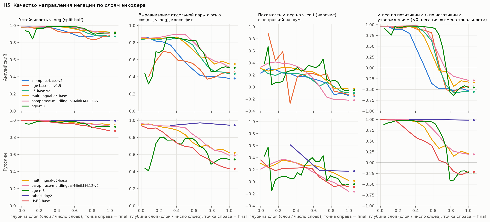
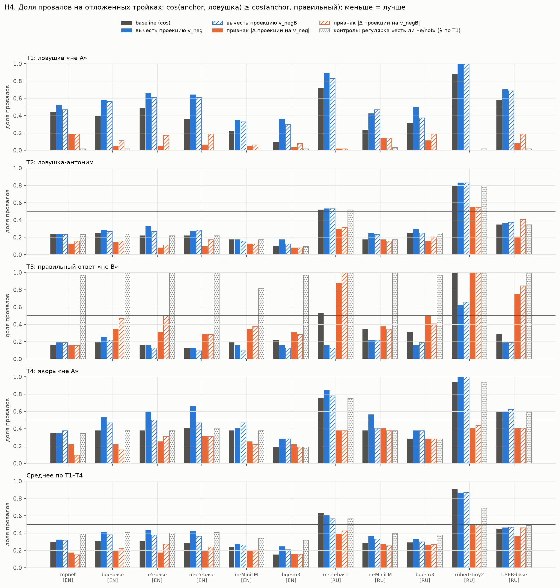

# Negation Direction in Sentence Embeddings

[Русская версия](README.ru.md)

A small research project: is there a stable **linear "negation direction"** in the final
embeddings of bi-encoder models (the vectors actually used for similarity search), like
"gender" in king − man + woman? And can one such axis fix *negation blindness*
("the movie is great" ≈ "the movie is not great") without fine-tuning?

- **Method:** DiffMean. `v_neg = mean(emb("… not …") − emb("…"))` over 240 minimal pairs per
  language, with four control directions (neutral-adverb insertion, antonym swap, random
  sentence difference, topic).
- **Models:** 6 for English, 5 for Russian (8 models total): all-mpnet-base-v2,
  bge-base-en-v1.5, e5-base-v2, multilingual-e5-base, paraphrase-multilingual-MiniLM-L12-v2,
  bge-m3, rubert-tiny2, USER-base. Every encoder layer is analyzed, not only the output.
- **Pre-registered:** pass/fail criteria for H1–H4 were written down before any results
  were computed ([RESEARCH_LOG.md](RESEARCH_LOG.md) §4). Verdicts are assigned by script.

## Short answer

**The direction exists, is stable, and is not "any edit" or "topic". But at the model output
it is largely a *polarity flip* rather than pure negation: close to the antonym direction.
Used as an extra feature on top of cosine it cuts negation errors a lot; projecting it out
of the embeddings hurts.**

| Hypothesis | Answer | Evidence |
|---|---|---|
| H1: a stable direction exists | **yes**, 11/11 | direction from two disjoint halves of the data: cos 0.87–0.95 (null ≈ 0) |
| H2: specific to negation | **partly** | orthogonal to "insert a neutral adverb" (−0.22…0.18), but overlaps with "swap for an antonym" (0.48–0.84 after noise correction) |
| H3: independent of topic | **yes**, 10/11 | 0.6–4.8% of its norm lies in the topic subspace, below the data-driven null |
| H4: practically useful | **as a feature yes** (8/11 strict, 10/11 lenient); **projecting out: no** | see below |
| H5: layers / languages / models | cleaner in middle layers; **the same direction for English and Russian** in multilingual models (cos 0.91–0.96) | see below |

### The main finding: at the output, "not" works like "flip the sentiment"



Compute `v_neg` only on positive statements ("the meeting was productive" → "…was not
productive") and separately only on negative ones ("the guests were rude" → "…were not
rude"). In all English models the two directions point **in opposite directions** at the
output layer (cos −0.29…−0.55, versus +0.83…+0.89 for a random split). "Not great" moves
toward "terrible", and "not rude" moves toward "polite". In early and middle layers this
does not happen (cos 0.88–1.00); the flip appears in the last ~40% of the network
(right-hand panel above). Russian shows the effect more weakly and not in every model.

If positive, negative and neutral statements are given equal weight (`v_negB`), what
remains is a stable (0.86–0.95), sentiment-free component. It detects negation in real
STS-B sentences with AUC 0.89–0.99, and it is **the same direction for English "not" and
Russian «не»** inside multilingual models (cos 0.90–0.95).

### Practical: add a feature, don't subtract



On a held-out set of (anchor, correct, trap) triples:

- **Projecting `v_neg` out** of the embeddings makes "X" and "not X" even closer: worse
  on the main trap type in 11/11 models (significantly in 10).
- **Feature** `cos(a, c) − λ·|a·v_neg − c·v_neg|` (λ chosen by cross-validation) cuts
  "the negation looks closer than the paraphrase" errors, for example 0.48 → 0.05 (e5-base-v2)
  and 0.72 → 0.02 (multilingual-e5-base, Russian). Averaged over all four trap types it
  improves results in 10/11 models.
- **Cost:** it penalizes correct answers that themselves contain a negation ("not closed"
  for the anchor "open"). This type gets worse in 9/11 models, significantly in 2. That is
  why the strict verdict is "partly" for those two.
- A regex baseline ("is there a *not*?") cannot do this: it either fully breaks the
  "not closed = open" case or changes nothing. Whitening hurts; mean-centering does nothing.

### A methodological trap worth knowing

A common stability check computes the direction on 4/5 of the data in each of 5 folds and
compares the folds. Such folds share 3/5 of their data, so even **pure noise gives ≈0.7**,
and its 99th percentile reaches 0.92–1.00. The naive threshold "> 0.7–0.8" passes
automatically. Use disjoint halves (null ≈ 0) and a sign-flip null.

## Using the directions

The directions (per model, per layer, plus the output layer) are in
[artifacts/v_neg/](artifacts/v_neg/). The format and a minimal example of the feature
are described there.

## Reproduce

```bash
pip install -r requirements.txt
cd src
python s01_build_data.py      # datasets (seed 42); downloads STS-B from Hugging Face
python s02_embed.py           # all-layer embeddings (~35 min on a 4-core CPU)
python s03_extract_h1.py      # v_neg + stability (H1)
python s04_h2_specificity.py  # controls, sentiment (H2)
python s05_h3_topic.py        # topic (H3)
python s06_h4_practical.py    # held-out triples (H4)
python s07_h5_transfer.py     # EN<->RU and cross-model transfer (H5)
python s08_figures.py         # figures
python s09_summary.py         # summary tables and verdicts
```

The embedding cache (~1 GB) goes to `D:/ml-cache/negation_direction` if that folder exists,
otherwise to `./cache`; override it with `NEGDIR_CACHE`.

| Path | Contents |
|---|---|
| [FINAL_REPORT.md](FINAL_REPORT.md) | full report (Russian) |
| [RESEARCH_LOG.md](RESEARCH_LOG.md) | decision log: pre-registered criteria, deviations, post-hoc analyses (Russian) |
| [results/summary_tables.md](results/summary_tables.md) | all summary tables |
| `results/` | per-model, per-layer metrics (CSV) and figures |
| `data/` | all generated datasets (STS-B sentences are rebuilt by `s01`) |
| `src/lexicon.py` | the hand-written base statements, antonyms and triples |

## Limitations

- Short template sentences, 48 base statements per language, only the explicit particle
  *not* / «не». Never / no / nobody, «нет», morphological negation and long documents were
  not tested.
- The held-out set for H4 is small (64 items per language), and λ is tuned by
  cross-validation on it. No external benchmark (e.g. NevIR) yet.
- The sentiment labels and antonyms were written by a single author. The balanced
  direction `v_negB` was added after seeing the data (post hoc).
- Only DiffMean. Probe-based directions and LEACE were not compared.

## License

MIT, see [LICENSE](LICENSE).
